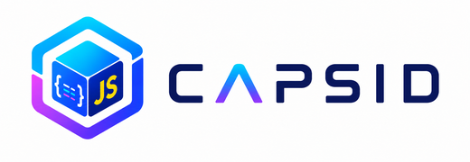

[](https://github.com/ErosZy/capsid/actions/workflows/testing-validity.yml)
[](https://github.com/ErosZy/capsid/releases)
[](LICENSE)

**Run generated JavaScript behind a Host-controlled boundary.** Capsid is an
embeddable runtime for self-contained ESM applications exporting a Web-standard
`fetch(request)` handler. Applications run in worker processes; the Host owns
listeners, routing, capabilities, resource limits and worker lifetime.

> **Stable**: `0.2.2`. **Prerelease**: `0.3.0-beta.2`. Public C ABI v7.
> The beta is experimental, not a stable-production recommendation. Only Linux
> strict sandboxing provides the production isolation boundary; native macOS
> and Windows support is for trusted development and integration.
>
> Documentation/data reviewed **2026-11-17** for `dev/v0.3.0`.
> [Current status and data scope](docs/current-status.md) separates the published
> beta, current source interface, measured development snapshot and dated history.

## Start Here

- **Run a local application:** [Getting started](docs/getting-started.md).
- **Choose or verify a package:** [Releases and installation](docs/releases.md).
- **Build the runtime or SDK:** [Building from source](docs/building.md).
- **Embed in your own C/C++ Host:** [Host integration](docs/host-integration.md).
- **Find a reference or design record:** [Documentation index](docs/README.md).

The default installer selects the latest stable release. Opt in to the beta
explicitly; it does not replace stable:

```sh
curl -fsSL https://github.com/ErosZy/capsid/releases/download/v0.3.0-beta.2/install.sh \
  | bash -s -- v0.3.0-beta.2
```

Packages are available for Linux x86_64 musl, macOS arm64 and Windows x86_64.
See the [installation guide](docs/releases.md) for SHA-256 verification,
Windows extraction and package contents.

## Application Model

```js
// app.bundle.js — already a self-contained ESM; no bundler needed here.
export default {
  fetch(request) {
    return Response.json({
      message: "hello from Capsid",
      path: new URL(request.url).pathname,
    });
  },
};
```

Capsid is not a general-purpose Node.js replacement. Applications do not own a
server listener, install packages at runtime, or receive ambient process access,
FFI or raw sockets. Bundle dependencies ahead of time and use Web-standard APIs.
Only [pinned framework versions](docs/framework-compatibility/README.md) carry
compatibility evidence.

| Responsibility | Host | Application |
| --- | --- | --- |
| HTTP service | Listener, TLS boundary, routing and admission | `fetch(Request)` and `Response` |
| Authority | Capability policy, egress policy and OS isolation | Explicitly authorized facades |
| External services | Trusted Bindings and credentials | Narrow asynchronous Binding methods |
| Failure and resources | Deadlines, cancellation, limits and process reclamation | Request-scoped work |

Inbound WebSocketPair/101 and outbound ws/wss are available within the documented
policy and lifetime boundaries. Start with the [inbound](examples/websocket.js)
and [outbound](examples/websocket-outbound.js) examples; consult the
[compatibility reference](docs/workerd-websocket-semantics.md) for limitations.

## Choose a Host Mode

| Mode | Purpose | Platforms |
| --- | --- | --- |
| `single-worker` | One local application and worker; development and integration | Linux, macOS, Windows |
| `static-pool` | A fixed local pool sharing one listener; integration and benchmarks | Linux, macOS, Windows |
| `managed` | Linux coordinator, application versions, Admin API and supervised pools | Linux only |

The local CLI is a development/benchmark entry point, not a production deployment
recipe. Managed mode is the first-party Linux production path, but its deployment
interface remains experimental. Neither mode selection nor successful startup
alone proves a secure deployment. See [Host configuration](docs/host-config.md)
and [platform support](docs/platform-support.md).

Application requests belong in `capsid.json`. Managed mode additionally uses a
Host-authoritative `host.json`; effective authority is the intersection of Host
limits and application requests. Unknown or invalid configuration fails closed.
Schema recognition is not proof that every resource field is enforced: App
`pidsMax` is not an effective per-App PID limit in this source. See the
[resource caveats](docs/capsid-json.md) before relying on a ceiling.

## Security Boundary

Separate processes are only one layer of isolation:

- `strict_sandbox` is off by default in the C API; default configuration is for
  trusted code only.
- When `egress_policy == NULL`, all egress Fetch requests are denied.
- `tjs:*` modules cannot be enabled through configuration.
- On Linux, verify that `CAPSID_EVENT_READY.flags` contains the sandbox features required by the deployment.
- Load only trusted bytecode produced by the matching build compatibility
  identity. Bytecode is not a safe format for untrusted input.

Current public modules require explicit authorization:

- Resource access: `capsid:env`, `capsid:fs`, `capsid:stdio`, `capsid:storage`,
  `capsid:system`.
- Permission queries: `capsid:permissions`.
- Utilities: `capsid:assert`, `capsid:getopts`, `capsid:hashing`, `capsid:ipaddr`,
  `capsid:utils`, `capsid:uuid`.

For untrusted workloads, configure the [Linux strict sandbox](docs/linux-sandbox.md),
[capability policy](docs/capability-policy.md), egress and surrounding OS/network
boundaries together. Read the [security policy](SECURITY.md) before deployment.

## Embed the Runtime

The SDK provides the C11 header `<capsid/runtime.h>` and the C++11 wrapper
`<capsid/runtime.hpp>`. Your Host drives the non-blocking request, credit,
streaming, cancellation and lifecycle APIs; the runtime does not replace your
HTTP server.

From a prepared source build:

```sh
cmake --install build-release --prefix "$HOME/opt/capsid-sdk"
```

See [building and SDK consumption](docs/building.md) and the
[embedding contract](docs/host-integration.md) before implementing a Host.
Bindings can expose trusted databases or other services without passing their
credentials or native handles to application code; their authority model is in
[Binding modules](docs/binding-modules.md).

## Compatibility, Validation and Performance

Capsid targets the documented `CAPSID-MIN-2025-subset-v0` Web API profile, not
complete ECMA-429 or browser compatibility. Required CI gates and pinned workerd
compatibility acceptance are not equivalent to every ordinary WPT passing.
Known raw failures and genuine prerequisite skips remain visible. The current
pinned workerd compatibility mapping is v2; five raw WPT file failures remain.
The ordinary suite is not represented as all-passing.

- [Testing guide](docs/testing-guide.md): local checks, full qualification and
  evidence boundaries.
- [Standards and conformance](docs/conformance.md): selected API surface and
  deviations.
- [Release qualification](docs/v0.3.0-current-qualification.md): source-bound
  beta results, original failures and remaining limits.
- [Performance methodology](docs/performance-benchmarks.md) and
  [historical charts](https://eroszy.github.io/capsid/): measurements belong to
  their recorded source, build, machine and protocol. Historical v0.2.2 numbers
  are not beta.2 measurements.

**Latest accepted local measurement:** snapshot `485b29b`, 2026-11-16, i5-12400F
under WSL2. JSON 1/16 KiB and stream throughput: **9341.6 / 8090.2 / 6491.7 QPS**;
service-tree PSS: **14.0 MiB** trickle / **18.0 MiB** loaded. Warm density under
the original 2048 MiB budget: **738 / 509 / 128 workers** at 10/100 KiB/1 MiB.
These are source-bound snapshot results, **not beta.2 benchmarks or a formal
paired improvement over v0.2.2**. The complete sealed archives and provenance
are linked from the [performance reference](docs/performance-benchmarks.md).

To contribute, follow [CONTRIBUTING.md](CONTRIBUTING.md). Planned work is tracked
in [ROADMAP.md](ROADMAP.md); dated reviews and handoffs are indexed separately
under [history and evidence](docs/history/README.md).

## License

[Apache-2.0](LICENSE) © Capsid contributors
